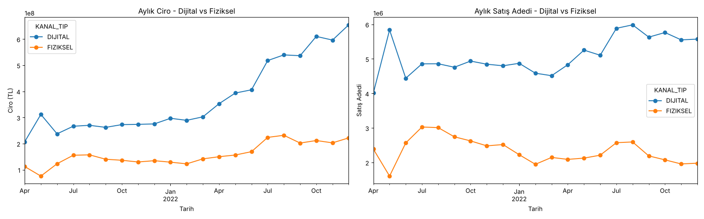
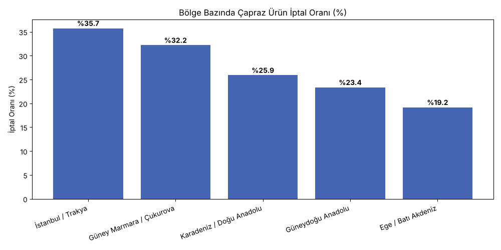

# Telco Sales Analytics: Digital vs Physical Channels

Sales analysis of a telecom company's monthly, dealer-level data (April 2021 – December 2022) to find where sales performance is weak, why, and what to change. Includes a January 2023 sales forecast for the main product and the cross-sold product, by channel.

Built as a case study during the Workintech Data Scientist & AI program and presented as a Looker Studio report. Data shared with the instructor's permission.

**Tools:** Python (pandas, NumPy, Matplotlib, statsmodels), Looker Studio

## Business questions

1. Is the company really growing, or is revenue growth driven by price increases?
2. Why are so many cross-sold products cancelled, and where is the problem concentrated?
3. Do regional demographics explain sales and cancellations?
4. How many units will each channel sell in January 2023?

## Key findings

| Area | Finding |
| --- | --- |
| Channel mix | The digital channel brings in **70.3%** of total revenue (7.87 billion TL). |
| Real growth | Digital revenue grew 216% while units grew 39%. Physical revenue grew 97.5%, but its unit trend **fell 17.9%**: price increases hide a shrinking channel. |
| Cancellations | Cross-sold product cancellation rate is **29.1% in physical stores vs 4.7% online**. Most physical cancellations happen 6–45 days after the sale, which points to customers who were not told enough at the point of sale, not instant regret. |
| Regions | Istanbul/Thrace has the highest cancellation rate (**35.7%**), Aegean/West Mediterranean the lowest (19.2%). |
| Demographics | Correlations between cancellation rate and city income, education or white-collar ratio are weak (0.16–0.24), so cancellations are driven by the sales process, not by customer profile. |
| Dealers | Revenue is highly concentrated: the top 10% of physical dealers generate 32.7% of physical revenue. |
| Customers | 41.5% of customers have been subscribers for 3+ years; new customers (0–3 months) are 11.6%. Foreign customers spend about 19% more per customer (dealer-month median). |





## January 2023 forecast

With only 21 months of data, seasonal models (SARIMA, seasonal Holt-Winters) need at least 24 months and were not reliable. Three simple methods were compared instead: linear trend, Holt (trend-only exponential smoothing) and year-over-year growth.

| Product | Channel | Forecast range (units) | Confidence |
| --- | --- | --- | --- |
| Main product | Digital | 5.57M – 5.71M | High (methods agree) |
| Main product | Physical | 1.75M – 2.08M | Medium |
| Cross-sold product | Digital | 42K – 68K | Low (sharp jump in the last two months) |
| Cross-sold product | Physical | 129K – 149K | Medium |

A 3-month backtest showed that a naive forecast (last value carried forward) had the lowest error, so the forecast is reported as a range rather than a single number.

## Recommendations

1. **Revise the physical sales process:** review the sales script and training, since late cancellations suggest the product is not explained correctly at the point of sale.
2. **Focus on Istanbul/Thrace:** investigate this region's sales team and management practices first.
3. **Change the commission model:** pay commission based on whether the sale is still active after 45 days, not only on the sale itself.
4. **Track real growth:** report unit volume alongside nominal revenue, so price increases don't hide falling demand.
5. **Reduce dealer concentration:** invest in mid-segment dealers to lower dependence on a few top stores.

## Data preparation

- **Digital channel:** the sales table has no channel column. Dealer `720983` sells far more than any other dealer and appears every month; it matches the digital channel in the cross-sales table, so it was labelled digital.
- **Dealer code mismatch:** dealer codes in the cross-sales table had an extra trailing `0` (`7209830` vs `720983`). Dividing by 10 matched all 1,212 dealers, which made it possible to add city information to sales data.
- **City names:** `Afyon` was renamed to `Afyonkarahisar` to match the demographics table.
- **Demographics:** district data was aggregated to city level, summing counts (population) and averaging rates and income.
- **Active customers:** subscriber counts were taken from the last month instead of summed across months, to avoid counting the same customer many times.

## Project structure

```
├── data/
│   ├── raw/telco_sales_analytics.xlsx    # original case data (3 sheets)
│   └── processed/                        # cleaned tables, created by the notebook
├── notebooks/
│   └── telco_sales_analysis.ipynb        # full analysis
├── images/                               # charts saved by the notebook
├── reports/
│   └── telco_sales_report.pdf            # Looker Studio presentation
└── requirements.txt
```

## How to run

```bash
pip install -r requirements.txt
cd notebooks
jupyter notebook telco_sales_analysis.ipynb
```

The notebook reads the raw Excel file, writes cleaned tables to `data/processed/` and saves all charts to `images/`.
